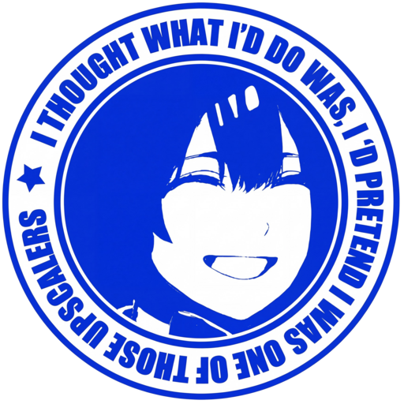
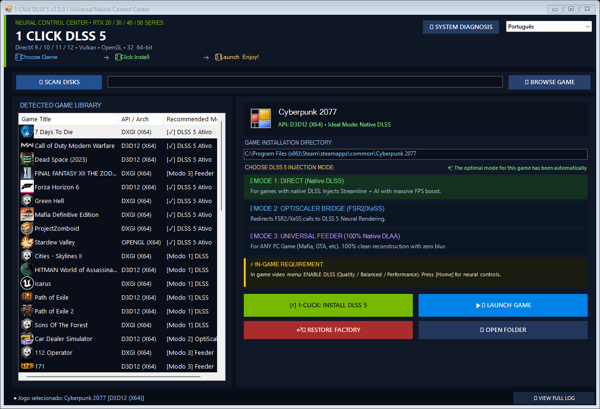
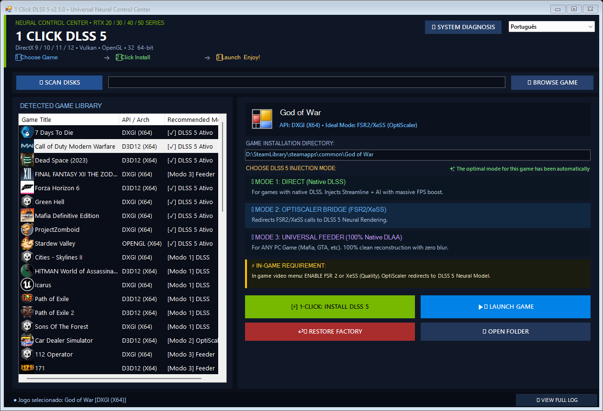
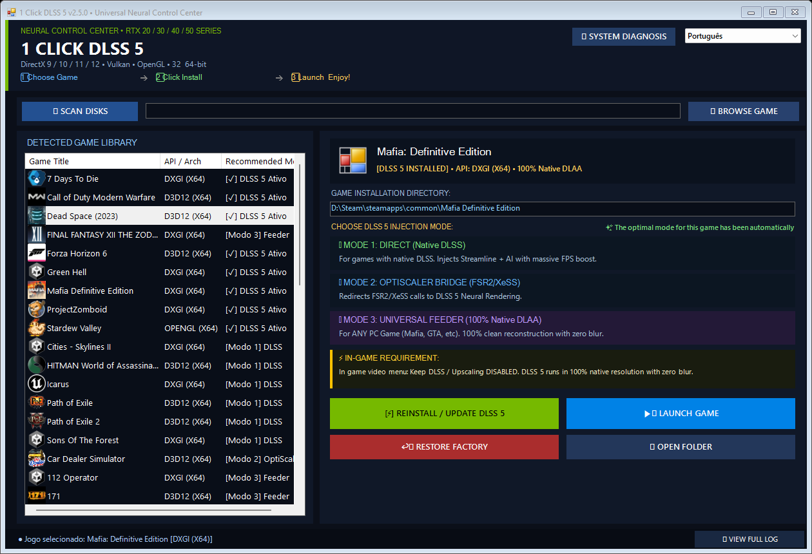

# 1-Click-DLSS5: Universal Steam-Style Game Center & Neural DLSS 5 Injector for Windows

### 🛠️ PowerShell Setup Button

   

---

1-Click-DLSS5 turns your entire PC library into a neural rendering playground, wrapping a Steam-style game center around a single, decisive button that injects DLSS 5 into practically anything you throw at it. Whether your title speaks DX11, DX12, or Vulkan, and whether your rig hums with an RTX 20, 30, 40, or 50 Series card, the tool quietly handles API detection and payload delivery so you can stay focused on playing. At its heart sits a 100% Native DLAA Feeder that reconstructs frames with zero blur and zero ghosting, even in games that never dreamed of supporting an upscaler. Modders are invited to peek under the hood, tinker with the pipeline, and make it their own.

## ✅ Before You Start

- Windows 10 or Windows 11
- PowerShell 5.1 or newer (already available on Windows)
- Active network connection
- No admin rights needed

## Features

- 🎮 **Steam-Style Game Center:** Your entire library, unified. Auto-discovery scans every drive and queries the Windows Registry for Steam, Epic Games, GOG Galaxy, Xbox Games, and custom install folders — no more hunting for executables in the dark.

- ⚡ **True 1-Click Injection:** Pick a game, hit the button, play. The engine handles API detection, payload placement, proxy setup, and calibration in one motion. No INI surgery, no manual DLL shuffling, no shader path puzzles.

- 🎯 **Deterministic API Detection:** The injector inspects each game's PE import table directly, sniffing out D3D11, D3D12, Vulkan, and OpenGL with surgical precision — even when the local DirectX runtimes are nowhere in sight.

- 📂 **Drag & Drop a Game:** Toss any folder or executable from File Explorer straight into the window and it's configured in seconds. Folder browsing beyond the detected library is fully supported for your weird, wonderful, and unlisted titles.

- 🧠 **100% Native DLAA Feeder:** For games with no upscaler at all, the feeder constructs a synthetic neural pipeline that evaluates at a full 1.0x scale factor — pristine anti-aliasing and reconstruction with zero blur and zero ghosting, straight from native resolution.

- 🌉 **OptiScaler Bridge:** Games running FSR 2/3 or XeSS don't get left behind. The bridge intercepts those calls and reroutes them entirely into the neural pipeline, turning a second-class upscaler into a first-class neural experience.

- 🔄 **Universal API Coverage:** DirectX 12, DirectX 11, DirectX 9, Vulkan, and OpenGL — the injector speaks every dialect your graphics stack can throw at it.

- 🧱 **32-Bit & 64-Bit Support:** A transparent IPC bridge lets modern 64-bit neural models reach into legacy 32-bit executables, so your classics get the same treatment as your newest releases.

- 🩺 **System Diagnostics Suite:** A built-in hardware checklist verifies tensor capabilities, write permissions, process states, and runtime integrity before you commit to an install — so you know the score before the first frame.

- ⚡ **1-Click Auto-Fix Engine:** File locked? Lingering process? Read-only folder? One button terminates stale processes, strips recursive read-only attributes, cleans runtime state, and re-applies the injection. Zero manual effort, zero hair-pulling.

- ↩️ **100% Clean Factory Restoration:** A surgical uninstaller that wipes every injected file while strictly preserving native game binaries — including protecting the game's own interposer and common DLLs. Your install goes back to vanilla, no residue, no regrets.

- 🌍 **10 Native Languages:** Full dynamic translation with instant switching — English, Portuguese (BR), Spanish, German, French, Italian, Japanese, Simplified Chinese, Russian, and Korean.

- 🖥️ **Native 64-Bit Executable:** Silent execution, embedded high-resolution icon, Windows 11 manifest, and Per-Monitor V2 High-DPI scaling. No console flashing, no ugly seams — just a clean, modder-friendly interface built to feel at home on your desktop.

- 🛠️ **Modder-Friendly by Design:** Every mode, every proxy, every payload is transparent and inspectable. Telemetry logs keep a continuous record so you always know what the injector did and why.

## Installation

Welcome, choom — you're about to wire raw neural reconstruction straight into your game library, and the good news is it takes about as long as brewing a cup of coffee. Here's how to get 1-Click-DLSS5 up and running without tripping over a single DLL.

**Step 1 — Land the Payload.** Grab the latest release archive for 1-Click-DLSS5 from wherever the project publishes its builds (the maintainers keep the release page tidy — you'll find the current version clearly stamped). Before you do anything else, verify your RTX hardware is awake: this suite is built for GeForce RTX 20, 30, 40, and 50 Series cards, so if your GPU badge doesn't match, stop here and save yourself the headache.

**Step 2 — Unpack Somewhere Sane.** Extract the archive to a folder you actually own — your Documents, a dedicated Mods drive, anywhere that isn't buried under Program Files and its permissions maze. The toolkit wants to write proxy DLLs and log files as it works, so give it breathing room. Resist the urge to run it straight out of the zip; Windows gets cranky about that.

**Step 3 — Wake the Control Center.** Launch the executable (your antivirus may mutter under its breath the first time — that's normal for a tool that touches game binaries; whitelist it if you trust the source, which you should, since you're reading the README). The Game Center interface will boot up and immediately start sniffing around for your installed titles.

**Step 4 — Let It Find Your Games.** The auto-discovery pass queries your storefront registries and multi-drive scans, so most Steam, Epic, GOG, and Xbox libraries will pop into view on their own. If a title is hiding in a custom directory, just drag the game folder or its executable straight into the window — drop-and-go, one second flat, no arcane path typing required.

**Step 5 — Pick Your Target and Pull the Trigger.** Select the game you want to upgrade. The suite will inspect the binary, detect which graphics API it speaks (DX11, DX12, Vulkan, OpenGL — it checks import tables, not just loose DLLs), and pre-select the ideal injection mode for you: Direct Mode for native DLSS titles, OptiScaler Bridge for FSR/XeSS games, or Universal Feeder for everything else. If you want to override its choice, the mode toggles are right there — go wild, you're a modder.

**Step 6 — One Click. That's It.** Hit the single install button and let the engine do its thing: it drops the right proxy wrappers, wires up the neural pipeline, and calibrates the feeder path. When it finishes, launch the game from the control center or your usual shortcut. Remember to flip the corresponding in-game setting (DLSS on for Direct Mode, FSR/XeSS on for Bridge Mode, and keep upscalers off for Feeder Mode, which runs at pure native resolution).

**If Something Stalls.** File locks, read-only folders, and stubborn background processes happen to everyone. The 1-Click Auto-Fix button exists precisely for that moment — it terminates lingering game processes, strips recursive read-only attributes, cleans stale runtime state, and re-applies the injection without you touching a terminal. The full telemetry log is one click away if you want to see exactly what the engine saw.

**The Golden Rule of Modding.** Always keep a clean backup of your game folder before your first injection. The suite ships with a surgical factory-restore option that preserves native binaries and wipes only its own injected files — but a backup is the modder's insurance policy, and you never skip insurance.

That's the whole ritual. No dependency wrangling, no manual INI archaeology, no shader-order gymnastics. Point, click, and let the tensor cores earn their keep.

## Compatibility

1-Click DLSS 5 is built to ride shotgun with the vast majority of your library — but the modding frontier is never perfectly flat, so here's the honest lay of the land.

**GPU Side:** You'll want an NVIDIA GeForce RTX 20, 30, 40, or 50 Series card under the hood. The neural reconstruction pipeline leans hard on tensor cores, and older GTX silicon simply doesn't have the muscle for the DLSS-NR model. Driver-wise, keep your Game Ready Driver at v535.xx or newer — the mod hooks into modern NGX runtime calls, and stale drivers are the number one cause of silent failures.

**Operating System:** Windows 10 or Windows 11, 64-bit only. The host64 bridge handles legacy 32-bit executables transparently, but the manager itself and the neural payloads are native x64.

**Graphics APIs:** DirectX 12, DirectX 11, DirectX 9, Vulkan, and OpenGL are all fair game. The engine inspects PE import tables directly, so it doesn't matter whether the game ships its own runtime DLLs or leans on the system ones — detection stays reliable.

**The Three Modes, Revisited:**

- **Mode 1 – Direct:** For titles with native DLSS already baked in. Streamline interposers and the RenoDX add-on upgrade the existing NGX path to full neural reconstruction. Think Cyberpunk 2077, Forza Horizon 5, Alan Wake 2, Hogwarts Legacy.
- **Mode 2 – OptiScaler Bridge:** For games that only speak FSR 2/3 or XeSS. The bridge redirects those calls straight into the DLSS-NR pipeline — God of War, Horizon Zero Dawn, Starfield, The Last of Us Part I territory.
- **Mode 3 – Universal Feeder:** The catch-all. Any DX11/DX12/Vulkan/OpenGL title with no native upscaler gets a synthetic DLAA device fed by the Lumenite Kernel's optical flow estimation. Mafia Definitive Edition, GTA V, Dark Souls III, Sekiro, Elden Ring, Halo Infinite — all welcome at the table. Even emulators like RPCS3 and Ryujinx can ride the feeder, though results vary by title.

**Engine Coverage:** Unreal Engine 4 and 5 titles with DX11 or DX12 runtimes are auto-detected and configured without fuss. Custom engines usually work too, as long as they respect standard swapchain and buffer conventions.

**Anti-Cheat Caveat:** This is the one place we wave a caution flag. Online multiplayer titles with kernel-level anti-cheat — you know the ones — will almost certainly flag injected proxy DLLs. Single-player and offline modes are the safe harbor. If a game's multiplayer component shares the same executable as its campaign, disable the mod before going online. No exceptions, no clever workarounds.

**Known Friction Points:** A handful of titles with aggressive file integrity checks may complain about modified binaries; the surgical uninstaller restores factory state cleanly when you need to verify. Games that run entirely through launchers with their own sandboxing can occasionally need a manual browse-and-drop instead of auto-discovery. And if a game already ships `sl.interposer.dll` or `sl.common.dll` natively — Witcher 3 and Cyberpunk being the classic examples — the restore logic preserves those originals untouched, so your vanilla install stays pristine.

**Not Supported:** Linux, Steam Deck (Proton), macOS, and any non-Windows environment. Cloud streaming clients are also off the table — the mod needs local file access and a real GPU.

## 📸 Screenshot

## Credits

Every frame this project renders stands on the shoulders of the modding giants who came before it. We are forever grateful to:

- **The RenoDX lineage** — for proving that ReShade add-ons could push neural uplift and HDR remastering beyond what the stock runtime ever intended.
- **The DLSS5-Feeder pioneers** — for modding open synthetic D3D12 DLAA and universal buffer transport, the very spark that taught non-DLSS titles to speak the language of neural reconstruction.
- **The LumeniteFX authors** — for the high-precision optical flow motion vector kernel that lets us synthesize believable motion data from thin air.
- **The OptiScaler crew** — for the proxy redirection magic that turns FSR2 and XeSS calls into neural gold.
- **The ReShade foundation** — for the injection runtime and add-on architecture that makes all post-processing wizardry possible.
- **NVIDIA** — for the DLSS SDK, Streamline, and NGX Neural Rendering, the silicon-level sorcery we merely orchestrate.
- **The artificial intelligence architects** — this project was designed, refactored, and engineered with the assistance of advanced generative reasoning models, turning a sprawling injection pipeline into a single, friendly click.

And to **you**, the modder reading this: thank you for keeping the spirit of open experimentation alive. Every game you tinker with, every bug report you file, and every frame you push further keeps this whole scene breathing.

## License

The code, shaders, and scripts forged into **1-Click DLSS5** are released under the **MIT License** — the same permissive, modder-first spirit that powers the entire custom graphics community. In plain terms: you can fork it, remix it, embed it in your own game center, ship it inside a paid mod pack, or experiment with it in ways the rest of us haven't dreamed up yet. All we ask is that you keep the original copyright notice and permissive license text intact when you redistribute, and that you don't hold the authors liable for anything that happens once neural upscaling meets a fragile save file at 2 AM. Attribution is appreciated but never demanded — the real currency here is what you build on top of it.

When you alternative open the engine, you'll find the mandatory `LICENSE` file sitting at the root of the project alongside the `1-Click-DLSS5.exe` binary and its supporting proxy DLLs. Every file it deploys into a game folder — the injected interceptors, the neural feeder add-on, the synthetic DLAA wrapper — inherits this same license, so there's no hidden trap door buried in a subdirectory. Bundle it with your own mod manager, repackage it as an offline installer, or strip it down to the injection core; the MIT grant travels with the code, and there's no separate commercial tier to negotiate.

Running the tool against any game remains entirely the responsibility of the person at the keyboard. **1-Click DLSS5** does not claim ownership over game assets, engine files, or anything it casually copies into a target directory as part of installation — those belong to their respective studios and publishers, and the license covers this project's own code, not the content it operates on. Deploying neural upscaling inside an online or competitive title can run afoul of anti-cheat systems and terms of service; that's on the modder who chooses to click the button, and the authors accept no liability for bans, crashes, corrupted saves, or frame-time fantasies gone sideways.

For the formal, legally binding wording — the full MIT text, warranty disclaimers, and the copyright line you must preserve — consult the `LICENSE` file shipped with the project itself. Use the code, learn from it, break it, rebuild it better. That's the point. Happy modding — and may your frame times stay low and your neural reconstruction stay sharp.